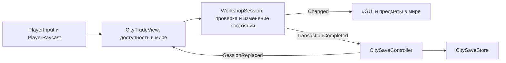

# Архитектура текущей реализации

Сверка исходников 22.10.2026, исходный commit `1771552`. Это описание существующего кода, не план рефакторинга и не результат запуска Unity. Правила города принадлежат [CITY_GAMEPLAY](CITY_GAMEPLAY.md), отдельного сценария — [FIRST_DEAL](FIRST_DEAL.md). Технические ограничения при изменениях — [ENGINEERING_STANDARD](ENGINEERING_STANDARD.md), выбор проверки — [DEVELOPMENT](DEVELOPMENT.md#verification-levels).

## Владение состоянием

| Ответственность | Реальный источник | Граница |
| --- | --- | --- |
| Экземпляры, деньги, батареи, тест и ремонт | [WorkshopSession.cs](../Assets/Scripts/Inventory/WorkshopSession.cs), [FlashlightUnit.cs](../Assets/Scripts/Inventory/FlashlightUnit.cs) | Один `WorkshopSession` владеет текущими тремя слотами. Тип товара и конкретный экземпляр различаются; `InstanceId` сохраняется при переносе |
| Партии, заказы, активные часы и выплаты | [WorkshopTrading.cs](../Assets/Scripts/Inventory/WorkshopTrading.cs) | Partial того же класса; не второй сервис экономики |
| Выкуп, учёт выручки/расходов, завершение FIRST DEAL | [WorkshopOutcome.cs](../Assets/Scripts/Inventory/WorkshopOutcome.cs) | Владение вычисляется из `Location`, итог денег не включает стоимость остатка |
| Карман, свободная постановка, ящик/багажник | [WorkshopCarrying.cs](../Assets/Scripts/Inventory/WorkshopCarrying.cs) | Модель разрешает переход; Unity проверяет физическую доступность и поверхность |
| Снимок и проверка восстановления | [WorkshopPersistence.cs](../Assets/Scripts/Inventory/WorkshopPersistence.cs) | Создаёт отдельный валидный кандидат, не меняет живую сессию по полям |
| Значения сохраняемого мира | [CitySaveData.cs](../Assets/Scripts/Inventory/CitySaveData.cs) | DTO содержит позиции/ID/числа, без GameObject и команд |
| Файл и резерв | [CitySaveStore.cs](../Assets/Scripts/Inventory/CitySaveStore.cs) | JsonUtility, envelope, checksum, временный файл и замена |
| Городская сессия и её замена | [CitySaveController.cs](../Assets/Scripts/Player/CitySaveController.cs) | Создание/загрузка, часы, autosave; `SessionReplaced` уведомляет адаптеры |
| Мир и городские действия | [CityTradeView.cs](../Assets/Scripts/Interactables/CityTradeView.cs) | Связывает сценовые точки, создаёт представления товара, проверяет reach/позы, вызывает операции модели |
| Городские окна | [CityTradeUI.cs](../Assets/Scripts/Interactables/CityTradeUI.cs), [CityPauseUI.cs](../Assets/Scripts/Interactables/CityPauseUI.cs) | Partial соответствующих компонентов, uGUI; не владельцы баланса |

Отдельных классов `Wallet`, `GameClock`, универсального каталога товаров и order service нет. Схемы ответственности в инженерном стандарте не требуют их создать. Runtime использует predefined assemblies; Editor-тесты физики и UI находятся в `HustleScale.Physics.Tests.asmdef` и вызывают общие проверки через reflection, не меняя runtime-границы.

## Инварианты экземпляра и сделки

`FlashlightUnit` хранит `InitialCondition`, фактическое `Condition`, `Location`, `IsTested`, `LastTestPassed`, `IsPowered`. `KnownCondition` выводится из результата теста. Включение света не заменяет профессиональную проверку. Успешный ремонт меняет состояние, расходует батарею и сбрасывает диагноз; перенос сам по себе его не сбрасывает.

Владение определяется `WorkshopSession.IsOwned`: Hands, Crate, Bench, Pocket, World. Seller, BuyerA, BuyerB и BoughtBack не являются запасом игрока. У ящика есть отдельные `IsCrateCarried`/`IsCrateInVehicle`; содержимое остаётся в Location.Crate, пока его не достали. Unity-объект — представление ID, не самостоятельная копия товара. Legacy [Inventory.cs](../Assets/Scripts/Inventory/Inventory.cs), `InventoryManager`, `Item`/`ItemFood` обслуживают старые предметы/слоты; не использовать их как второй баланс или реестр продаваемых фонарей.

`DeliverOrder` и `SellBack` сначала проверяют всю предъявленную группу: разные существующие ID, допустимое местоположение, диагноз, качество, количество, статус/срок заказа и предел кошелька. Только затем меняют Location, деньги и заказ. Любой отказ оставляет группу и оплату прежними. UI передаёт ID, а не сумму выплаты. В городе Pocket также означает предъявленный переносимый запас; UI выбирает точное количество подходящих ID, не меняя строгий контракт DeliverOrder. PurchaseCityLamp покупает один слот Seller за $60 в Pocket; оставшиеся Seller учитываются в доступности А/Б. Лимит — две партии по три. Валидатор v6 пересчитывает расходы по числу слотов вне Seller и запрещает неизрасходованные Seller в истории предыдущей партии. Повторное взаимодействие с проданным ID или закрытым заказом не должно давать денег.

`Complete` вызывает `Changed`, затем `TransactionCompleted`; эти события выполняются синхронно. `Changed` также вызывается для паузы/тика часов без сделки. Не сохранять файл на каждый UI refresh и не считать любое событие новой продажей. Сейчас даже успешный перенос запрашивает autosave через `TransactionCompleted`.

## Заказы и время

В `WorkshopTrading` определены `DealOrderId` и `DealOrderState`. Переходы: Available → Accepted → Completed; Available → Declined/Expired; Accepted → Cancelled/Failed. Нехватка общего оставшегося запаса переводит Available/Accepted в Unavailable. Locked относится к RepeatB. Закрытый заказ не возвращается в Available; новая городская партия создаёт новые A/B, сохраняя предыдущие отдельно.

`ElapsedSeconds` принадлежит сессии. `AdvanceActiveSeconds` принимает конечное неотрицательное значение и учитывает старт, паузу и завершение. `CitySaveController.Update` синхронизирует паузу и передаёт `Time.deltaTime`; в FIRST DEAL часы продвигает `FirstDealView`. У сценария фиксированные сроки от выхода, у города — от принятия конкретного заказа. На границе `ElapsedSeconds >= DeadlineSeconds` передача уже невозможна. Ремонт прибавляет время и может сорвать принятый заказ. Полного календаря/суточного цикла нет.

## Unity, ввод, UI и NPC

- [PlayerController.cs](../Assets/Scripts/Player/Movement/PlayerController.cs): CharacterController, ходьба/гравитация в Update, камера в LateUpdate, захват курсора и `CanInteract`. Это не Rigidbody-контроллер и не физическая симуляция веса товара.
- [PlayerInput.cs](../Assets/Scripts/Player/PlayerInput.cs): собственная `InputActionMap` создаётся в Awake, включается/выключается с компонентом. `IA_PlayerInput.inputactions` и сгенерированный класс также существуют, но не являются источником текущих клавиш этого адаптера. Не подключать второй обработчик E/Tab.
- [PlayerRaycast.cs](../Assets/Scripts/Player/PlayerRaycast.cs): ближайший твёрдый hit до 2,5 м блокирует дальнейшее взаимодействие; `IWorldInteraction`/`GrayboxInteractable`, затем legacy pickup. Предметы ставятся после Unity-проверки поверхности/пересечений; это не свободный бросок Rigidbody.
- [Подсветка подбора](PICKUP_FEEDBACK.md): тот же hit запрашивает `IPickupTarget`, и `PickupOutline` рисует контур доступного предмета без подмены его материалов. `WorkshopPickupAvailability` читает текущие ограничения сессии; контур не даёт дополнительных прав на предмет. В M2 экранный прицел выбирает видимую модель, перенос и контакт используют отдельные физические положения рабочих концов.
- [CitySceneBindings.cs](../Assets/Scripts/Player/CitySceneBindings.cs) явно связывает игрока, камеру и городские адаптеры, проверяет сценовые роли и локальные точки префабов. `CityGreyboxWalk` больше не добавляет Save/Trade при запуске. `CityTradeView` создаёт только представления текущего товара/ящика и UI; стационарные игровые объекты уже находятся в сцене. Настройка и ограничения — [сборка сцены](CITY_GAMEPLAY.md#сборка-сцены-в-unity-editor).
- Город использует uGUI Canvas/Text/Button/ScrollRect, EventSystem с InputSystemUIInputModule; [CityTradeStyle.cs](../Assets/Scripts/Interactables/CityTradeStyle.cs) задаёт оформление, `CityTradeView.Refresh` обновляет представление по `Changed`. Предложения/пауза/карта модальны; мастерская E/T/R работает без окна. Макеты двенадцати экранов и gamepad-навигация в Art Direction не доказывают реализацию всех этих экранов/ввода.
- [WorkshopView.cs](../Assets/Scripts/Interactables/WorkshopView.cs), [FirstDealView.cs](../Assets/Scripts/Interactables/FirstDealView.cs), [WorkshopCarryController.cs](../Assets/Scripts/Interactables/WorkshopCarryController.cs) обслуживают отдельный fixture. Перезапуск заменяет его сессию через существующий сценовый путь; не смешивать с городским save.
- [FirstDealCharacter.cs](../Assets/Scripts/Interactables/FirstDealCharacter.cs), [CityTradeReaction.cs](../Assets/Scripts/Interactables/CityTradeReaction.cs) показывают реакции на сессию. NPC закреплены у торговых точек; расписаний, NavMesh-поведения и самостоятельной экономики нет. Наличие пакета AI Navigation не означает работающий NPC AI.

При городской загрузке `Bind` отписывается от прежнего `Changed`, подключается к новой сессии и восстанавливает представление. `CitySaveController` переподключает `TransactionCompleted`; уничтожаемые адаптеры снимают свои подписки. При правке lifecycle проверять повторную загрузку, выход/вход в Play Mode и потерю фокуса, а не только один Start.

## Сохранения и восстановление

Текущий контракт форматов и пользовательские действия — [CITY_GAMEPLAY](CITY_GAMEPLAY.md#сохранения-и-восстановление). Payload v6 (с чтением v1–v5) и envelope `HustleScale.City.1` имеют разные версии. `CitySaveStore` ограничивает чтение 256 КиБ, проверяет SHA-256 payload, затем передаёт данные `TryRestoreCity`. Checksum выявляет повреждение, но не является защитой от редактирования.

Валидатор сопоставляет баланс с расходами/выручкой, ремонты/батареи, проданные ID, статусы/оплаты заказов, обе партии и world-позы. После успеха контроллер меняет сессию целиком и оставляет игру на паузе; неудача оставляет прежнее состояние и сообщение. Сохранение сначала записывает `.tmp` с Flush, затем заменяет основной файл; исправный основной становится `.backup`, повреждённый не затирает хороший резерв. За рулём save/load/new game запрещены. Перед сохранением `BeforeSave` собирает позиции мира. `BeforeExplicitSave` нормализует прерванную работу станции только при явной записи/паузе/выходе. Autosave проверяет `AutosaveReady` и свободную рабочую руку, не выполняет ручную постановку крышки и не прерывает контакт. Autosave по транзакциям не равен непрерывному сохранению каждой секунды движения.

## Расширение и известные ограничения

Модель намеренно специализирована: три активных фонаря, до двух городских партий, два текущих заказа и отдельный RepeatB fixture; M5 добавляет один отдельный фонарик и одноразовый заказ пайки, не расширяя обычные партии. Цены/требования находятся в коде; ScriptableObject-каталога этих сделок нет. DTO используют Unity Vector3 и JsonUtility, поэтому слой сохранений не полностью независим от Unity. В UI-адаптерах сосредоточено создание мира, проверка расстояний и представление. Это границы текущей реализации, не поручение немедленно разнести классы.

Новый тип товара требует сначала отдельного игрового контракта: количество, состояние/диагноз, правила владения/переноса, сделки, влияние на старые saves. Затем исследовать фиксированные массивы и проверки именно в перечисленных файлах. Расширять их только под согласованный товар; не создавать универсальную экономику ради гипотезы. Проверять совместимость старого товара и недопустимые/повторные передачи по [матрице проверок](DEVELOPMENT.md#verification-levels).

## Пайка M5

[WorkshopSoldering](../Assets/Scripts/Inventory/WorkshopSoldering.cs) — узкий partial общей сессии: оборудование, отдельный `SolderingLamp`, дозы, диагноз, состояние разборки/пайки и заказ `Solder`. `Units` сохраняет три обычных слота; `CityUnit(3)` явно адресует дополнительный экземпляр только в городе. Подсчёт доступности А/Б и новой партии использует прежний обычный запас. `ConnectionFault`, `SolderBuyer`, `Solder` дописаны в enum без перенумерации старых значений.

Сессия владеет общими состояниями `FlashlightRepairState`/`SolderingTrialState`; supply callback проверяет запас и расходует одну дозу, события обновляют экземпляр и запрашивают запись. [SolderingTrial.City](../Assets/Scripts/Interactables/SolderingTrial.City.cs) связывает их с прежней M3, останавливает действия при замене сессии и нормализует только незавершённый перенос/рабочую руку. Sandbox M2/M3 остаётся отдельным, со своим локальным состоянием. `CitySolderingView` подключает существующий `CityStationSite`, переключает станцию/силуэт/табличку и показывает предложения в прежних магазине/покупателе Б. `CityStationSite` проверяет свободное место через локальный Transform, учитывая его поворот.

[WorkshopSolderingPersistence](../Assets/Scripts/Inventory/WorkshopSolderingPersistence.cs) дополняет общий валидатор: глобально уникальный ID, один Hands/Bench, возможная сборка, `HasSolder`/прогресс/дозы, финальный тест, исход продажи и одна оплата в пересчитанном балансе. `LampPurchased` обязателен как признак покупки: JsonUtility представляет отсутствующий inline-объект пустыми полями. Старые версии проходят прежние инварианты и получают пустое расширение, v5 заменяет живую сессию только после всех проверок. Правила и результаты — [M4/M5](M4_SOLDERING_INTEGRATION.md).
