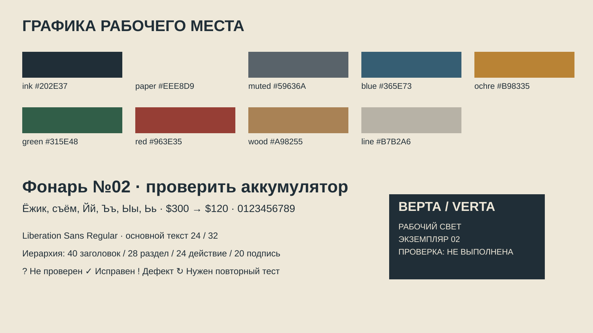
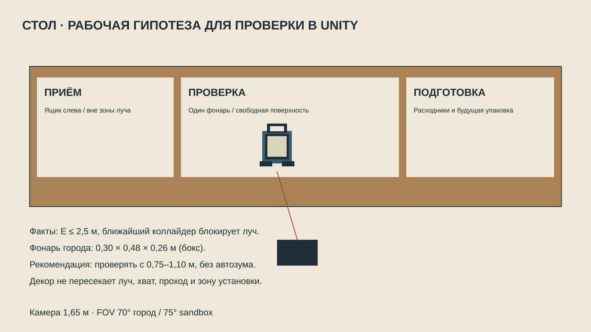
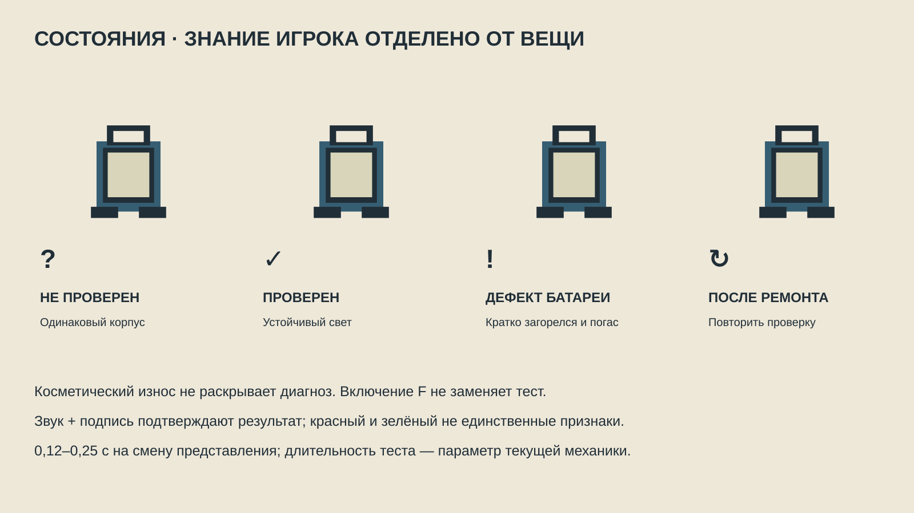

# HUSTLE & SCALE — Art Direction v1.0

Направление задано 20.10.2026; статус уточнён 21.10.2026. **E5 принят владельцем.** Это руководство по стилю и будущим изменениям, не список незакрытых работ. Приёмка относится к интегрированному срезу, а не автоматически ко всем макетам будущих экранов. Текущий этап — [ROADMAP](../ROADMAP.md#current-status); доказательства — [VALIDATION](VALIDATION.md).

Начать просмотр с [визуального стенда](index.html), [основного концепта](selected/gameplay/workshop-concept.png) и [критериев соответствия и истории исследования](VISUAL_EVALUATION.md). Источники и фактический аудит — в [RESEARCH.md](RESEARCH.md); производство и протокол проверок — в [PRODUCTION_GUIDELINES.md](PRODUCTION_GUIDELINES.md).

## Порядок применения, 20.10.2026

Художественное направление сохраняется; очередь производства задаёт [DEVELOPMENT_PLAN](../DEVELOPMENT_PLAN.md). Порядок: полный торговый цикл → образец E5 → расширение порциями. Первые два рубежа приняты; сейчас проверяется E6.6. Существующие ArtDirectionTest и ассеты переиспользуются; не создавать все модели, весь UI и оформление города заранее. До E5 допустимы узкие пробы стиля и визуал, необходимый для понимания действия. Будущие ситуации и прогрессия ниже — художественный ориентир, а не разрешение на новые механики.

## 1. Итоговое направление владельца

**Простая игровая 3D-стилизация в стиле Schedule I; конкретный дизайн и контент — собственные.** Рабочее название художественного пакета — «Рабочий квартал», без буквы варианта. Это не Stylized Realism и не попытка объединить реализм с мультфильмом.

Пожелание владельца относится именно к визуальному стилю: похожая простая геометрия, условные стройные персонажи с простыми лицами, небольшое число крупных деталей, обычные игровые материалы и свет. Нельзя трактовать референс только как абстрактную «читаемость», а затем уводить результат в другой стиль. При этом модель, персонаж, улица, вывеска и интерфейс создаются для Hustle & Scale, без обводки и переноса конкретных ассетов Schedule I.

Фотореализм и первоначальный Stylized Realism исключены. Диснеевская/Pixar-округлость, игрушечная уютность, рекламная вылизанность и случайные AI-украшения также исключены. Графический comic/cel и «технический альбом» не являются действующими альтернативами: последнее уточнение владельца уже определило нужный стиль.

Что должно быть похоже на Schedule I: степень упрощения зданий и пропов, стройные условные люди, простые глаза и рот, спокойные материалы, игровой свет и прямой вид от первого лица. Что должно быть своим: форма и черты конкретного лица, причёски и одежда, модели товаров, архитектурные модули, планировки, упаковка, шрифтовая композиция, графика HUD и торговых экранов. Сходство стиля не требует копировать конкретного человека в зелёной футболке или интерфейс референса.

Язык Hustle & Scale опирается на путь вещи: получить → проверить → организовать → передать. Прямые рабочие поверхности, синие корпуса оборудования, бумажные идентификаторы и понятные места хранения дают собственную предметную тему в том же простом игровом стиле. Цвет и композиция образцов — рабочие предложения, не отдельные новые пожелания владельца.

В первоначальном задании B означал Stylized Realism. Позднее та же буква была ошибочно использована для другого подхода. **Такое обозначение больше не применяется к действующему направлению.** Старые каталоги `exploration/direction-*` сохранены только ради стабильности ссылок и истории; они не задают производство.

Растровые концепты показывают характер. **Точные игровые подписи, геометрические размеры, деньги и состояния задаются кодом и SVG-макетами.** Перспектива генератора не является обмером. Три фонаря на общей поверхности концепта — показ партии; активная диагностическая зона рассчитана только на один экземпляр.

## 2. Визуальные принципы и запреты

1. Сначала силуэт и назначение, затем материал, затем одна функциональная деталь. Если предмет непонятен без надписи с рабочей дистанции, исправить форму.
2. Большие спокойные поверхности; детали концентрируются у захвата, переключателя, крышки батареи и контактной зоны.
3. Степень упрощения одинакова у человека, товара и помещения. Детализированная реалистичная голова рядом с простым фонарём не проходит приёмку.
4. Рабочие места различаются организацией и назначением. Цвет не заменяет планировку, вывеску или силуэт оборудования.
5. Читаемость сохраняется при выключенной подсветке и без постоянного маркера цели.

Запрещены: фотореалистичная грязь и поры кожи; пухлые игрушечные пропорции; большие добрые улыбки по умолчанию; фаска на каждом ребре; случайная полигональная гранёность; декоративные неон/блум; постоянное дрожание камеры; ковёр UI-панелей; обещание качества товара цветом до диагностики. Для принятого художественного результата простота формы требует осмысленных пропорций и цвета. На этапах E2–E4 серый грейбокс допустим; это руководство не требует оформлять весь город до проверки цикла.

## 3. Палитра и графическая иерархия

| Токен | HEX | Применение |
|---|---|---|
| Ink | `#202E37` | Текст на бумаге, резина, опорная UI-плашка |
| Paper | `#EEE8D9` | Меню, ценники, документы, светлый текст на Ink |
| Muted | `#59636A` | Вторичная подпись на Paper |
| Equipment | `#365E73` | Корпуса и редкие фокальные элементы; не универсальный интерактивный цвет |
| Identity | `#B98335` | Номер партии, фокус, метка зоны; не цвет ошибки |
| Verified | `#315E48` | Подтверждённое исправное состояние после теста |
| Fault | `#963E35` | Подтверждённый отказ и неисправность, обязательно со знаком/словом |
| Timber | `#A98255` | Дерево и рабочие поверхности; не фон для мелкого текста |
| Rule | `#B7B2A6` | Разделители; не цвет значимой подписи |

Цветовые значения — цели образца, не требование заменить существующие материалы. Рабочее правило кадра: большая нейтральная масса, меньшая масса предметов, редкий сигнальный акцент. Не заливать каждую дверь отдельным насыщенным цветом.

## 4. Типографика, иконки, маркировка

Основной шрифт пакета — **Liberation Sans Regular**, уже присутствующий в проекте. SIL OFL 1.1 приложена рядом с [шрифтом](selected/typography/LiberationSans.ttf). Используем исходный файл без изменения имени и очертаний. Для текущих макетов достаточно Regular; визуальное усиление заголовков средствами рендера не означает наличие отдельного лицензированного Bold-файла. Для внедрения настоящий Bold следует получить из той же лицензированной семьи либо оставить Regular с более крупным кеглем. Golos Text проверен как возможная OFL-альтернатива с кириллицей, но не стал зависимостью: загрузка из среды была недоступна.

Размеры ниже — дизайн-единицы при эталоне 1600×900, не физические пиксели на любом мониторе: заголовок 40/48, раздел 28/36, основной текст 24/32, действие 24/32, подпись 20/28. Макеты допускают 17–19 только для служебной метки стенда; обязательная игровая информация так не уменьшается. Цены и таймеры с равной шириной области, выравнивание чисел вправо. Если гарнитура не даёт табличных цифр, фиксировать ширину числовой колонки, не добавлять пробелы для выравнивания.

Не писать длинные реплики капителью. «Не проверен», «дефект батареи», «нужен повторный тест» не сокращать до непонятных кодов. Поддержка Ёё/Йй/Ъъ/Ыы/Ьь, цифр, `$`, № и русских сообщений обязательна. Для `✓`, `↻` и других символов предпочтительны свои векторные пиктограммы: шрифт не должен быть скрытой зависимостью состояния.

Графика: квадратная линза в ручке — оборудование; коробка — хранение; лист с одним срезанным углом — документ; батарея с `+`/`−` — расходник. [Восемь редактируемых пиктограмм](selected/typography/iconography.svg) построены из векторных paths независимо от шрифта. Толщина линии 2 единицы при иконке 24; оптически упрощать на 16. Состояния: `? + Не проверен`, `✓ + Исправен`, `! + Дефект`, `↻ + Повторить тест`. Цвет дублирует, не заменяет знак. Unicode-значки в отдельных UI-строках — композиционные образцы; при внедрении использовать соответствующую векторную форму.

Физические ценники содержат товар, количество и сумму. Проверочная бирка появляется только после результата и связана с экземпляром. Бирка на корпусе не должна закрывать переключатель. Упаковка: обычный картон и бумага; вымышленная марка **ВЕРТА / VERTA** — предложение графического имени, не юридически проверенный бренд. На коробке — силуэт товара, ID, состояние знания, место хранения. Не делать вымышленную упаковку источником несуществующей гарантии, качества или бонуса.

## 5. Моделирование и предметы

| Категория | Решение формы | Что не моделировать |
|---|---|---|
| Фонарь / hero | Корпус-прямоугольник, отдельная ручка, утопленная линза, опора, доступная крышка батареи | Каждую LED-ячейку, резьбу винта, микроперфорацию |
| Ящик | Три читаемых места, прорези захвата, жёсткая рамка | Десятки отдельных гвоздей и случайные щепки |
| Прибор / расходник | Крупный дисплей или шкала, один переключатель, видимые клеммы | Схему реальной электрической цепи |
| Стол / стеллаж | Прямые столешницы, ножки и рабочий просвет | Малозаметные крепежи на обратной стороне |
| Фасад / background | Вход, этажность, крыша, крупный материал, одна отличительная вывеска | Уникальную геометрию каждого кирпича |

Фаски только на силуэтных кромках, которые действительно ловят свет с игровой камеры. Сглаживание сохраняет прямые плоскости; не превращать корпус в мыло. Маленькая деталь становится геометрией, если меняет силуэт или участвует в действии; иначе крупная текстурная отметка или её удаление.

Модули среды: стены с проёмом/без, прямой простенок, угловой элемент, стол, стойка, стеллаж, навес. Сетка привязывается к существующему помещению и проходимости, а не к универсальной новой норме. Масштаб 1 Unity unit = 1 м подтверждать контрольным объектом при импорте. Pivot товара — устойчивый низ; вторичный grip-point — ручка. Коллизия проще визуала, не по каждой фаске. Сохранять реальные GUID и ссылки; новый меш подключать через отдельный prefab-образец после приёмки.

Факты размеров: старый детализированный prefab имеет корпус 0,24×0,28×0,18 м, опору шириной 0,29 м; городская runtime-заглушка — бокс 0,30×0,48×0,26 м. Они не взаимозаменяемы без проверки позы и зоны установки. **Для первого переноса сохранить городской коллизионный габарит**, вписать внутрь читаемую ручку/корпус; уменьшение коллизии отдельным решением после проверки. Размеры в растровом sheet описывают корпус/опору старого пропа и не определяют полный городской collider.

## 6. Материалы и износ

Техническая отправная точка — существующие URP-материалы, а не новый шейдер. Приведённые значения roughness/smoothness — диапазоны настройки образца, не измеренные свойства материалов.

| Поверхность | Художественное требование | Недорогой способ / старт настройки |
|---|---|---|
| Сталь | Более чёткий блик, чем у пластика; крупные плоскости | URP Lit, metallic близко к 1 для голого металла, smoothness 0,3–0,5 |
| Краска | Цвет корпуса важнее царапин | Metallic 0 у покрытия; smoothness 0,15–0,3; редкий скол открывает другой слой |
| Пластик | Спокойный цвет, слабый блик | Metallic 0, smoothness 0,15–0,3 |
| Резина | Тёмная, читается контуром на светлом столе | Metallic 0, smoothness 0,05–0,15; не абсолютный чёрный |
| Линза | Видимая глубина рамки; выключенная линза не светится | Непрозрачная светлая вставка для первого образца; emission по состоянию |
| Стекло | Локальный материал, не весь кадр отражений | Прозрачность только где нужна; сначала проверить непрозрачную имитацию |
| Картон | Плоские панели, видимые клапаны | Одна base-color текстура/атлас, без прозрачности и микрорельефа |
| Бумага | Светлая, без шума под текстом | Непрозрачная плоскость, крупная печать; отдельная читаемая экранная копия |
| Дерево | Направление волокон и стык досок | 1 неброский tile; нормаль не нужна до доказанной пользы |
| Текстиль | Силуэт одежды, складка локтя/плеча | Цветовые зоны и несколько крупных складок; без ткани на каждом пикселе |
| Штукатурка | Большая нейтральная масса | Слабые пятна крупного масштаба, углы/проём задаёт геометрия |

Износ причинный: ручка затёрта ладонью, опора касается пола, старая наклейка оставляет прямоугольное пятно. У трёх экземпляров разные косметические следы, но **неисправность батареи не кодируется уникальной трещиной или красной деталью до теста**. «Дешёвый», «подержанный», «повреждённый», «проверенный» — разные оси. В FIRST DEAL нет нового качества/редкости: нельзя вводить «зелёный качественный лут» оформлением.

## 7. Люди и анимация

Взрослые стройные фигуры в той же условной манере, что в игровых кадрах Schedule I: длинные простые руки и ноги, голова слегка вытянута; конкретные лица создаются своими. Рабочая стартовая пропорция 7–7,5 высот головы с небольшой условностью, без большого детского черепа. Глаза — простые белки/зрачки и умеренное веко; нос малой формы; рот короткой линией/простой плоскостью. Волосы — несколько цельных масс, не пряди. Не копировать конкретного персонажа Schedule I.

На первую художественную пробу: **одна базовая фигура/риг, три варианта одежды и головы** для продавца/A/Б. У продавца расслабленная стойка у партии; у A рабочая одежда и краткий взгляд на прибор; у Б спокойная стойка у точки выдачи. Не закреплять честность или платёжеспособность за внешностью. Требования покупателя читаются из условий сделки, а не из стереотипного лица.

Минимальные анимации: idle с редким переносом веса, взгляд на товар, короткий жест предъявления/приёма, подтверждающий кивок. Никакой бесконечной активной жестикуляции. Челюсть/лицевая система и липсинк для первого образца не нужны. Существующий `Male_Casual.fbx` и условные NPC — кандидаты для технического каркаса; лицензия и соответствие стилю должны быть проверены до включения в новый production prefab.

## 8. Среда и композиция

| Место | Характер и ориентир | Функциональный центр |
|---|---|---|
| Начальная мастерская | Простой прямой объём, светлая стена, синяя дверная рама | Стол с пустой зоной для одного теста; ящик сбоку |
| Место покупки | Открытый навес и низкая стойка; партия видна с прохода | Ценник на стойке, доступное место для ящика рядом; фиксированный док не требуется |
| Осмотр | Нейтральная подложка и фронтальный рабочий свет | Одна вещь, прибор, доступная крышка батареи |
| Хранение | Стеллаж и крупные подписи мест | Физический порядок, одинаковые идентификаторы с инвентарём |
| Упаковка [будущее] | Свободный край поверхности, бумага, закрытая коробка | Логичная последовательность без перекрёстного переноса |
| Встреча с покупателем | Уличная ниша или простой прилавок | Человек, свободное место предъявления, условия возле него |
| Развитое помещение [будущее] | Повторяемые рабочие зоны и более ясная маркировка | Снижение хаоса, параллельные операции; не просто дорогая отделка |

Снаружи районы различаются формой крыш, шириной улицы, вывесками и типом работы. Гаражи — низкие длинные проёмы, рынок — навесы и прилавки, жильё — частые окна, склад — высокие ворота. Не заменять текущую карту новым кварталом ради концепта. Декоративные коробки не похожи на интерактивный товар по силуэту и расположению.

В кадре от первого лица оставлять чистый фон за маленьким товаром. Инструмент не перекрывает луч взаимодействия. Вывеска сообщает «Продавец фонарей», а не `Seller/Lots` и не координаты отладки. Рабочий маршрут читается дверным проёмом, прилавком и улицей; карта остаётся доступной, обязательной стрелки единственной стратегии нет.

## 9. Камера и пространственные рекомендации для первой пробы

Подтверждено: камера 1,65 м от начала игрока; FOV sandbox 75°, города 70°; луч E до 2,5 м; ходьба 4 м/с, ускорение ×1,5 по исходнику. Камера переносимого городского фонаря получает локальную позу `(0,38; −0,4; 0,7)`, ящика — `(0; −0,85; 1,1)`. Эти позы — факты текущего представления, не разрешение на смену управления.

Рекомендации **для измерения, не проверенная эргономика**: взгляд на товар на дистанции 0,75–1,10 м от линзы камеры; активная зона теста в центральной трети видимого стола; у таблички целевой экранный размер ключевой строки не меньше 20 дизайн-единиц, иначе показывать экранную копию. При FOV 70° предмет высотой 0,48 м на 1 м занимает приблизительно 34% высоты кадра по формуле `h/(2d·tan(FOV/2))`; это оценка без наклона камеры и перспективного сокращения.

Проверить размещение на реальном городском столе `(-72; 1,25; 34)` и подходе к нему. Не предлагать новую высоту стола до измерения существующей поверхности и позы фонаря. Используемая диагностическая область в старом prefab — 0,7×0,55 м, её удобство для города отдельно не доказано. Для прохода брать существующую капсулу и габарит ящика, а не только ширину фигуры. Переносимый ящик пока без коллизии — чистый кадр не доказывает отсутствие пересечений со стенами.

## 10. Освещение: замысел и реализация

| Ситуация | Artistic intent | Technical implementation / рабочая проба |
|---|---|---|
| День | Читаемые плоскости, интерьер не проваливается в чёрный | Существующий Directional Light + ambient; одна согласованная экспозиция |
| Вечер [вариант] | Холоднее улица, теплее жилое окно; предметы не теряют цвет | Сначала отдельный lighting preset образца; суточный цикл не внедряется |
| Рабочий стол | Можно осмотреть выключенный фонарь | Один локальный нейтральный источник; старт 4000–4500 K как художественная цель |
| Магазин | Равномерно видны лицо, товар, условия | Простые fixtures, ограниченное число локальных источников, без тени у каждого |
| Малое помещение | Контакт с полом и стеной, без грязной завесы AO | Существующие тени/renderer feature; интенсивность оценивать по кадру |
| Фонарь включён | Состояние устройства видно по линзе и свету | Emission + существующий Light, а не чрезмерный bloom |

URP подтверждён. HDRP, ray tracing, Cinemachine и новый toon-shader для текущего направления не нужны. Не менять текущие pipeline assets и postprocessing в этой задаче. Для первой художественной сцены достаточно имеющихся URP Lit, света и теней; bake/reflection probe добавлять только после проверки необходимости. Отражения передают материал, не служат украшением. UI имеет непрозрачный фон: контраст не зависит от экспозиции сцены.

## 11. UI: форма и информационная архитектура

Для новых экранов: краткое содержание, заметный заголовок, крупная сумма и главное действие. Принятый городской UI E5 использует компактные карточки с иллюстрациями; не заменять его старым макетом без конкретного замечания. Срезанный угол применяется к физической бирке/документу, не ко всем кнопкам. Разделитель допустим только между смысловыми группами. Не нужен веб-dashboard с карточкой на каждый показатель.

Все [12 редактируемых экранов](selected/interface/hud.svg) доступны в [стенде](index.html). Это дизайн и независимые состояния, не интегрированное меню Unity.

| Экран / SVG | Основная информация и размещение | Первичный фокус / выход |
|---|---|---|
| [Главное меню](selected/interface/menu.svg) | Слева название и вертикальные действия, справа спокойный вид мира | Продолжить, если есть валидное сохранение; иначе Новая игра; выход требует доступного действия |
| [HUD](selected/interface/hud.svg) | Баланс слева сверху, принятые обязательства справа, контекст у нижней центральной области, 3 слота снизу | Игра владеет вводом; prompt не перекрывает объект |
| [Инвентарь](selected/interface/inventory.svg) | Строки физических экземпляров слева, место и состояние в каждой; справа выбранное и расходники | Последний выбранный экземпляр; Esc возвращает в игру |
| [Товар](selected/interface/item.svg) | Предмет слева, известные сведения справа | Вернуться к контексту; скрытое состояние не показывается |
| [Диагностика](selected/interface/inspection.svg) | Предмет/контактная зона слева, подтверждённый результат и следующий доступный шаг справа | Проверить; после результата — доступное действие; повторный тест после ремонта |
| [Покупка](selected/interface/purchase.svg) | Партия слева; количество, цена, деньги до/после справа | Уйти/назад безопасны; подтверждение покупки явно называет $180 |
| [Продажа](selected/interface/sale.svg) | Предъявленные ID и состояние слева; требования, остаток времени и выплата справа | Передать только когда предусловия выполнены; неполная группа не списывается |
| [NPC / предложение](selected/interface/dialogue.svg) | Короткая реплика; количество, качество, цена, начало срока; принять и уйти | Уйти без обязательства; принятие явно запускает срок города |
| [Финансы](selected/interface/finance.svg) | Начальные деньги, расходы, выручка, текущие деньги, товар отдельно | Закрыть; нет победного экрана вместо мира |
| [История](selected/interface/history.svg) | Хронологические строки с операцией, ID, суммой, балансом | Последняя строка; сортировка/фильтры только при реальной потребности |
| [Развитие](selected/interface/growth.svg) | Что меняется в работе и помещении, условия и стоимость, когда они определены | Сейчас информационный образец с недоступной покупкой |
| [Настройки](selected/interface/settings.svg) | Текст, движение, язык, звук, камера, управление по категориям | Текущее поле; Esc возвращает на предыдущий экран |

У финансов/истории/развития нет обещания реализации: в игре существует компактный учёт, но эти полные новые экраны не подключались. Будущая история должна хранить реальные события модели, не восстанавливаться из красивой анимации.

Компоненты: кнопка минимум 48 дизайн-единиц по высоте, подпись действия с глагола; поля с постоянной подписью и причиной ошибки под полем; вкладка имеет underline/рамку и текст, не только оттенок; списки с отдельной строкой на экземпляр; таблицы только там, где нужно сравнение сумм; диалог не глубже одного подтверждения; значок количества рядом с предметом; toast не заменяет обновление баланса/запаса. Disabled объясняет причину рядом и не делает текст неразборчивым.

Навигация: Tab/Shift+Tab по видимым контролам, стрелки в списке, Enter/Space активирует выбранное, Esc снимает верхний экран; фокус сохраняется при возврате. В модальном экране фокус не уходит за его пределы. Для реализации на uGUI использовать существующий EventSystem/InputSystemUIInputModule и явные переходы Selectable; поддержка геймпада — требование проекта макета, пока не проверенный факт. UI получает `Changed`/результат операции от текущей модели. Анимация оплаты не владеет экономикой.

Layout: эталон 1600×900; безопасные поля 28, модальная область 1240×675 в образцах; внутренний шаг 8, основной отступ 24–40. В Unity сохранить существующий эталон 1280×720 на первом переносе и перевести величины пропорционально, а не механически копировать пиксели. 16:10 добавляет вертикальное пространство; 21:9 оставляет основные чтения в центральной области максимум 1600 дизайн-единиц, боковая ширина отдаётся миру. Длинный текст и 125–150% требуют reflow/scroll, а не обрезки и уменьшения кегля. SVG в стенде масштабируется целиком: это проверка композиции, **не доказательство reflow готового игрового UI**.

## 12. Где живёт информация

| Носитель | Что показывать | Экранная страховка |
|---|---|---|
| Ценник/коробка | Товар, партия, цена/ID | E открывает точные условия |
| Бирка проверки | ID и известный результат | Дублирование в инвентаре |
| Прибор | Начало/ход/результат теста | Краткая подпись результата; звук необязателен для понимания |
| Вывеска | Название места, без отладки | Карта доступных торговых мест |
| Context overlay | Только ближайший доступный объект, действие и отказ | Не виден сквозь стену; не даёт удалённую продажу |
| Полное меню | Условия обязательства, выбор предъявленных ID, настройки | Пауза времени/движения по текущему контракту |

Малые действия взять/положить/включить не требуют отдельного полноэкранного меню. Нельзя прятать дедлайн только на маленькой бумаге или начинать его до объяснения условий.

## 13. Действия, motion и звук

Предлагаемые длительности — **только визуальная оболочка**, не изменения затрат времени/правил. Если текущая механика длится иначе, сначала согласовать сочетание; +240 игровых секунд ремонта остаются неизменными. Не задерживать повторное действие до окончания косметической анимации.

| Исходное → ввод | Анимация / визуал / звук | Подтверждение; ошибка; возврат |
|---|---|---|
| Предмет доступен → взять E/1–3 | 0,18–0,25 с к существующей held-позе, тихий хват резины | Обновлён ID в руках; заняты руки — причина, без движения; назад к idle |
| В руках → перенос | Минимальный sway 0–0,5° как регулируемая проба, без качания всего мира | Тот же ID и место; постановка недоступна — outline зоны + текст; остановка гасит sway |
| Осмотр → поворот [новая возможность] | Локальный поворот предмета, без движения камеры, мягкое торможение 0,12 с | Это предложение UX, поворот сейчас не реализован; Esc возвращает исходную позу |
| У стола → положить Q/E по текущему контексту | 0,15–0,2 с, короткий звук контакта | Смена местоположения; нет свободной поверхности — предмет остаётся в руках |
| На столе → проверить | Существующее действие теста, индикатор и свет; один click + короткий электрический отклик | Результат меняет знание; отсутствие предмета — отказ; прибор возвращается в idle |
| Тест выявил дефект | Одна короткая вспышка, затем выключение, подпись `Дефект аккумулятора` | Бирка/статус только после теста; уменьшение вспышек заменяет её подписью |
| Тест успешен | Устойчивый свет, знак и подпись, короткий сухой tick | Проверенный ID, без конфетти; свет не слепит интерфейс |
| Дефект + своя батарея → заменить | 0,6–0,9 с крышка/снятие/установка как будущая проба, 2–3 сухих звука | Тратится батарея, +04:00, знание сброшено; нет расходника — ничего не меняется; вернуть предмет |
| Готовый товар → упаковать [будущее] | Бумага складывается 0,3–0,45 с, короткий бумажный шорох | Не добавляет качества/стоимости в текущих правилах; до реализации только концепт |
| Принятый заказ + предъявление → передать | Короткий жест NPC 0,25–0,4 с; исчезновение только переданных ID | Выплата после успеха модели; неполный/неверный/просроченный заказ — причина, все предметы остаются |
| Успешная передача → деньги | Число `+$260` появляется на 0,8–1,2 с, сухой звуковой штамп | Постоянный баланс уже обновлён; повторный сигнал не повторяет оплату; toast исчезает |
| Оборудование/улучшение [будущее] | 0,3–0,6 с смена вида после принятой операции, металлический щелчок | Нужны отдельные правила и цена; никакого автоматического ремонта комнаты после продажи |

Ошибки не трясут камеру и не мигают полноэкранным красным. Не вводить hit-stop, изменение `timeScale`, squash предметов или новый tween-пакет ради торговли. Свойства модели меняются атомарно до подтверждения представления; звук, бирка и число не дают второй выплаты. Короткие переходы можно сделать имеющимися coroutine/Animator после отдельной реализации.

## 14. FIRST DEAL: пять ситуаций одного образца

Художественная демонстрация ниже создана для фиксированного состава FIRST DEAL: $300 → покупка 3 за $180 → $120; два исправных и один дефект батареи скрыты до теста. Это исторический сценарий сравнения макетов, **не гарантированный состав текущей городской партии**. В городе после E6 независимый RNG, максимум две покупки; актуальный контракт — [CITY_GAMEPLAY](../CITY_GAMEPLAY.md).

| Ситуация | Что видно и зачем | Образец |
|---|---|---|
| 1. Старт | Стол, ящик/док, прибор, полка, выход; назначения читаются расположением | [HUD](selected/interface/hud.svg), [пространство](selected/environment/spatial-rules.svg) |
| 2. Получение | Три единицы одной модели, ID без достоверного диагноза; до/после оплаты | [Покупка](selected/interface/purchase.svg), [проп](selected/objects/asset-sheet.png) |
| 3. Проверка | Один предмет в активной зоне, прибор, результат отдельно от косметики | [Диагностика](selected/interface/inspection.svg), [состояния](selected/interactions/states.svg) |
| 4. Продажа | NPC, принятый заказ A, предъявлены проверенные 01+03; $260 и остаток срока | [Сделка](selected/interface/sale.svg) |
| 5. Результат | $380 наличных; расходы $180, выручка $260; неисправный 02 ещё товар | [Финансы](selected/interface/finance.svg), [будущее помещение](selected/environment/progression.png) |

Эта последовательность — сравнимая художественная демонстрация, не обязательный маршрут игрока и не новая реализация экономики. В FIRST DEAL фиксированные сроки от смены и RepeatB остаются для старой сцены; в городе A/B 9/18 минут от принятия, выкуп после покупки, нет RepeatB/автофинала. Вся партия неисправной не становится от одного плохого результата. «$380» — деньги, а «+$80» — денежное изменение относительно старта при оставшемся товаре, не полная прибыль с учётом его стоимости.

## 15. Рост бизнеса и перенос на другие товары

От хаотичного совместного использования стола — к выделенным местам, маркировке, расходникам под рукой, стандартизованной упаковке, отдельным зонам приёмки и выдачи. Меняется читаемая структура работы, затем вместимость, затем тип пространства. Стерильность не является конечной наградой.

Будущая мебель, обувь или инструмент используют тот же язык: крупная форма, понятный захват/назначение, локальные следы эксплуатации, ID и состояние знания. Не делать символ фонаря общим логотипом всей игры: он относится к первой партии. Упаковка, жесты и стоимость подготовки потребуют правил для соответствующего товара.

## 16. Критерии для следующей художественной итерации

Это повторно используемые критерии, не текущий backlog и не отмена принятой E5. Проверять применимые пункты в пределах конкретного изменения; результаты и ограничения записывать отдельно.

- [ ] Новая порция соответствует принятому образцу на кадре, NPC и крупном плане предмета; при изменении художественного решения требуется оценка владельца.
- [ ] С рабочей камеры 70° узнаются ручка/опора/крышка, глаза NPC не становятся главным акцентом сцены.
- [ ] Нейтральный свет позволяет отличить сталь, краску, резину и картон без шумных текстур.
- [ ] Непроверенный дефект не раскрыт цветом/биркой; после ремонта нет зелёной отметки до повторного теста.
- [ ] Читаются деньги, количество, качество и срок; инвентарь показывает реальное место каждого ID.
- [ ] Значимая подпись имеет контраст ≥4,5:1; состояние различается без цвета и звука.
- [ ] В 16:9, 16:10, 21:9 и на минимальном целевом окне не перекрыты товар, prompt и подтверждение; 150% текста проверено в реализации отдельно.
- [ ] На реальных маршрутах работают коллизии, E, переноска, постановка, фокус/пауза; нет визуальных пересечений с руками и ящиком.
- [ ] Производительность измерена на целевом Player и оборудовании; никакого обещания FPS из концепта.
- [ ] Лицензии, GUID, prefab/scene references сохранены; новые production-ассеты подключены только отдельной принятой итерацией.

Концепты и SVG остаются дизайн-источниками; они не подтверждают реализацию всех показанных экранов и улучшений. Интегрированный городской образец E5 реализован и принят в записанных границах. Фактические игровые проверки, кадры и ограничения — в [VALIDATION](VALIDATION.md); очередная порция проверяется отдельно.
